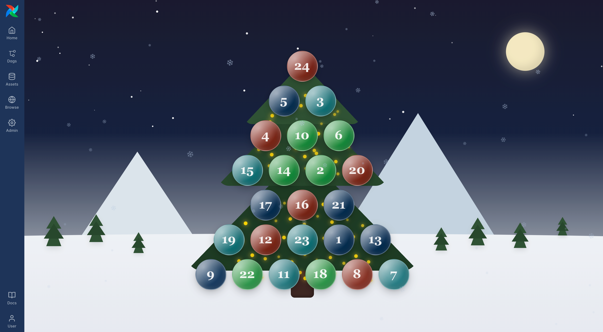

🎄 Airflow Advent Calendar 2025 ❄
=================================

Happy Holidays! What is the best part of the holiday season? Opening advend calendar windows of course! That 
is why I made an Airflow Advent Calendar. 🥰  

How to open the windows
=======================

1. Fork the repository and clone it to your local machine. 
2. Make sure you have the [Astro CLI](https://www.astronomer.io/docs/astro/cli/install-cli) installed and are at least on version 1.34.0. 
3. Run `astro dev start` to start the containers running Airflow. 
4. Open the Airflow UI at http://localhost:8080/.
5. Click on the DAGs view and you should 24 Dags, each for one day of the advent calendar. Run the Dag of today to open the window. You cannot open windows for future days.
6. Click on the **Browse** button and then on **Advent Calendar** to see the advent calendar plugin. Once a window has been opened you can click it to view your present for the day. 😊

📊 Global Dag Gantt plugin
==========================

A second plugin lives in this repo: a **macro Gantt view** showing every `DagRun` of a day
(all DAGs on one shared timeline) to spot bottlenecks and global overlaps — the native
Airflow Gantt only covers one DAG at a time.

- Backend: `plugins/dag_gantt_plugin.py` — FastAPI app at `/dag-gantt-plugin`
  (`GET /api/runs?date=YYYY-MM-DD`, day window in UTC, public like the advent plugin)
  + the React app registration (`react_apps`).
- Frontend: `plugins/react-src-dag-gantt/` — React widget built with **bun + webpack**.
  It reuses the libraries Airflow 3.3 exposes on `globalThis` (`React`, `ChakraUI`,
  `ReactRouterDOM`, …) via webpack `externals`: nothing is bundled, so the widget gets
  the host theme (and the D2B brand colors from `.env`) for free.
- Demo data: `dags/gantt_demo.py` (unpause with `astro dev run dags unpause gantt_demo_finance`
  / `gantt_demo_quality`, catchup fills the day; `gantt_demo_slow` is manual — trigger it
  and watch the running bar stretch).

How to use it
=============

1. `astro dev start` (after changing the widget: `cd plugins/react-src-dag-gantt && bun install && bun run build`; after changing Python: `astro dev restart`).
2. Browse → **Dag Gantt**: pick a date, filter by DAG name, tag or state, click a bar to open the run's Grid page.

> Note: new DAG files are picked up by the dag-processor on discovery; if a brand-new file
> doesn't show up, restart the dag-processor container and unpause the DAGs.