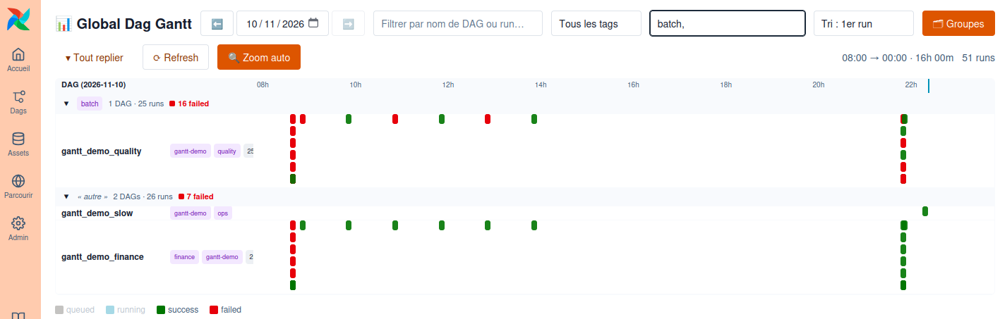

# 📊 Global Dag Gantt — plugin Airflow 3

Un plugin **Airflow 3** qui affiche **tous les runs de la journée, tous DAGs confondus**, sur une
seule ligne de temps. Le Gantt natif d'Airflow est confiné à un seul DAG : impossible de voir d'un
coup d'œil ce qui s'est vraiment passé sur la plateforme — enchaînements, chevauchements, goulots.
Il se distribue comme un **vrai paquet pip**, découvert automatiquement par Airflow — aucun fichier
à déposer dans `plugins/`.



La ligne de temps **zoome automatiquement sur les runs filtrés** (minimum 3 h, graduations
adaptatives, journée complète à la demande) ; la légende fait aussi office de **filtre multi-états**
et l'état de la vue — date, recherche, tag, états, tri, zoom, groupement — voyage dans l'**URL** :
un simple copier-coller partage exactement la même image de la plateforme.

- **Une ligne par DAG**, une barre par run, positionnée et dimensionnée en temps réel ;
- **DAGs groupés par tag principal** (détection auto du tag le plus fréquent, ou liste d'étapes
  priorisées façon `collecte, normalisation, export`) — en-têtes repliables, lignes compactes ;
  `?group=0` revient à la liste plate ;
- **Couleurs et thème 100 % natifs** : le widget consomme le design system d'Airflow, branding
  d'instance inclus (mécanisme expliqué en §2.3) ;
- **Filtres instantanés** (nom de DAG/run, tag, état) sans rappel serveur ;
- **Runs en cours** : la barre s'étire jusqu'à l'instant T, vue rafraîchie toutes les 30 s ;
- **Clic sur une barre** → ouverture de la page Grid du run.

**En pratique :** menu **Parcourir → Dag Gantt**, choix de la date. C'est tout.

---

## 1. De quoi on parle

**Airflow** est un ordonnanceur de workflows écrits en Python : on décrit des **DAGs** (graphes de
tâches), il planifie, exécute, réessaie, surveille. Cinq composants à connaître : le **scheduler**
(déclenche), les **dag-processors** (lisent les fichiers de DAGs), les **workers** (exécutent), la
**metadata database** (toute l'histoire des exécutions — c'est elle que lit ce plugin) et l'**API +
UI web** (React, Chakra UI). Un **plugin** s'y branche sans le forker : une API FastAPI d'un côté,
une page React ajoutée à la navigation de l'autre (§2.1).

**Astro CLI** (Astronomer) encapsule un projet Airflow local dans Docker Compose : un dossier de
projet, quelques commandes, un environnement complet (Airflow 3 + Postgres) sur le poste. Ici deux
commandes suffisent, `astro dev start` et `astro dev stop` ; **tout le reste est piloté par
`./dev.sh`** (§3.2).

**Ce qui tourne vraiment** : runtime `3.3-12` = Airflow **3.3.2+astro.3** sur **Python 3.14** — le
`-12` est le *patch du runtime Astro*, pas la version de Python. Python visé par le paquet :
**3.12 → 3.14** (le runtime 3.3 les supporte tous les trois, 3.14 par défaut). La wheel est
`py3-none-any` : **une seule** wheel pour les trois versions, aucun build par interpréteur.

**Héritage** 🎄 — ce dépôt s'appelait `airflow-advent-calendar` : il part de l'[airflow-advent-calendar][tamara]
de **Tamara Fingerlin** ([son article][tamara-article]), 24 DAGs qui ouvrent 24 fenêtres de décembre
dans l'UI Airflow. Le volet advent est **sorti du dépôt le 2026-11-09** (il vit chez elle, plus dans
`git log --diff-filter=D -- plugins/ dags/day_1.py`). Ce qui reste de lui est structurel, pas
nostalgique : la mécanique « un état lu en base → un rendu custom dans l'UI, sans toucher au cœur
d'Airflow », l'association `react_apps` + `fastapi_apps`, le bundle servi par le plugin, les
`externals` vers les librairies de l'hôte — et le `bun`. Merci Tamara 🙏

---

## 2. Créer un plugin React pour Airflow 3

### 2.1 Deux moitiés

Un plugin Airflow 3 « avec écran », c'est :

1. **une app FastAPI** (Python) déclarée via `fastapi_apps` : elle sert l'API de données **et** le
   fichier JS du widget ;
2. **un bundle React** (JS) déclaré via `react_apps` : l'UI d'Airflow le charge avec un `import()`
   natif et affiche le composant trouvé sur `globalThis` (nommé d'après le `name` du plugin,
   fallback `globalThis.AirflowPlugin`).

L'app FastAPI est **montée à la racine** de l'URL d'Airflow sous son `url_prefix` (ici
`/dag-gantt-plugin`), donc le widget la rappelle en same-origin — pas de CORS.

### 2.2 Le build : webpack + bun

Le widget vit dans `js/` (JSX) et compile en **un seul fichier** `js/dist/dag-gantt-widget.js`, que
le hook de build hatchling **embarque dans le paquet Python** (`airflow_dag_gantt/static/`, §4.2).
`bun` tient lieu de npm — même écosystème, plus rapide (`bun.lock` fige les versions) :

```bash
cd js
bun install      # une fois (webpack/babel : uniquement pour le build)
bun run build    # → js/dist/dag-gantt-widget.js
bun run dev      # idem, en --watch et non minifié
```

> ⚠️ Ce qui précède est le cycle de **livraison** (bundle → wheel → image). Pour **travailler**, ne
> jamais repayer ce cycle : `./dev.sh watch` pousse le bundle dans le conteneur qui tourne en ~1,2 s,
> sans restart ni wheel (§3.2).

### 2.3 Le mécanisme « externals + globalThis »

L'UI d'Airflow 3 **expose ses propres bibliothèques** sur `globalThis` (`React`, `ChakraUI`,
`ReactRouterDOM`…). Grâce aux `externals`, notre bundle ne contient **aucune librairie** (~12 Ko) et
consomme celles de l'hôte : mêmes versions, **mêmes couleurs et composants Chakra que l'UI native**
— branding d'entreprise compris.

```js
// js/webpack.config.js
externals: {
  react: 'React',                    // window.React fourni par l'UI Airflow
  '@chakra-ui/react': 'ChakraUI',    // idem — et le thème de l'instance
  'react-router-dom': 'ReactRouterDOM',
}
```

Un faux plugin de 10 lignes suffirait : un composant, un `index.js` qui fait
`globalThis['Mon Nom'] = MonWidget;`, et côté Python
`react_apps = [{"name": "Mon Nom", "bundle_url": "/mon-plugin/mon-widget.js", …}]`.
**Piège classique** : la clé `globalThis` doit être _exactement_ le `name` du `react_apps`.

---

## 3. Développement local

### 3.1 Démarrer

```bash
# Prérequis : Astro CLI (≥ 1.34) + Docker — et bun seulement pour rebuilder le frontend.
cp .env.example .env                 # nom d'instance + thème UI (.env n'est jamais versionné)
./build.sh                           # bundle JS + wheel dans dist/  (§4.2)
astro dev start                      # l'image du projet installe la wheel (voir Dockerfile)

astro dev run dags unpause gantt_demo_finance
astro dev run dags unpause gantt_demo_quality
astro dev run dags trigger gantt_demo_slow   # ~3 min : une barre « running » qui s'étire
```

Puis **Parcourir → Dag Gantt** 🎉. Il n'y a **plus de dossier `plugins/`** (ni `include/`) dans ce
dépôt : le plugin vient du paquet, donc plus de « je modifie le fichier et je redémarre ».

### 3.2 `./dev.sh` : trois lois physiques, mesurées

Deux moitiés, deux vitesses — c'est ça qui structure le dev (chiffres mesurés sur ce poste) :

| Ce que vous changez | Ce qui doit recharger | Délai |
| --- | --- | --- |
| **JS/JSX** (`js/src/`) | rien côté Airflow : `api.py` sert le bundle par `FileResponse`, **relu à chaque requête** (+ `cache-control: no-cache`) → `astro dev restart` inutile | **1,2 s** + refresh navigateur |
| **Python** (`api.py`, `plugin.py`) | le **processus** : Airflow ne charge les entry points qu'au démarrage | **8,5 s** |
| **`pyproject.toml` / `Dockerfile`** | l'image entière | **~20 s** |

```bash
./dev.sh watch             # terminal 1 : webpack --watch + copie auto à chaque compile
./dev.sh js                # ou à la main : bundle (1,2 s) → Ctrl+Shift+R
./dev.sh py                # .py → site-packages + restart api-server ; --all = 4 processus
./dev.sh full              # ./build.sh + astro dev restart ← LA VÉRITÉ, avant de committer
./dev.sh url               # URL directe de l'api-server (le port change à chaque restart)
./dev.sh api 2026-11-09    # le contrat JSON sans ouvrir le navigateur
./dev.sh logs              # journal de l'api-server
```

`dev.sh` retrouve **lui-même** le bon conteneur (celui dont le `dags/` monté est celui de ce dépôt)
quand plusieurs environnements `astro dev` tournent en parallèle.

Le composant React n'a **pas** de HMR, et ce n'est pas un accident : `bundle_url` est monté par l'UI
Airflow qui remonte le widget à chaque navigation, donc un refresh à 1,2 s vaut un Fast Refresh — et
un webpack-dev-server du poste dupliquerait une **seconde** instance de React dans la page (les
`externals` viennent de l'hôte, §2.3). Le vrai goulot reste le restart Python : 8,5 s, pas 2 minutes.

> ⚠️ `js`, `watch` et `py` écrivent **dans le conteneur** : c'est **jetable**. Un `astro dev
> restart`/`kill` ou un rebuild remet la wheel d'origine — d'où `./dev.sh full` avant de committer.
> Cas tordu vérifié : si le dernier `dev.sh js` arrive **après** le dernier `./build.sh`, le restart
> suivant ré-installe la wheel d'avant le correctif — le navigateur obtient un bundle
> *neuf-et-vieux* (nouvelles fonctions présentes, correctif absent, **aucune erreur console**).
> Règle : après la dernière modif JS, le dernier mot est à `./build.sh`, jamais à `dev.sh js`.
> Le bundle de la loop courte est celui de `webpack --mode development` (non minifié, stack traces
> lisibles) : il n'est pas comparable à celui de `./build.sh`.

> ⚠️ Deux particularités vérifiées : `astro dev pytest` est cassé par le thème JSON multiligne de
> `.env` (refusé par `docker run --env-file`) → lancer `pytest` soi-même (§3.4) ; et un **nouveau**
> fichier de DAG n'est pas détecté à chaud (`dag_discovery_safe_mode`) →
> `docker restart <projet>-dag-processor-1`.

### 3.3 Où vit quoi

```text
pyproject.toml                    métadonnées du paquet + entry point airflow.plugins (py 3.12 → 3.14)
LICENSE                           MIT — embarquée dans le wheel (`license-files` du pyproject)
hatch_build.py                    hook : câble js/dist → src/airflow_dag_gantt/static
build.sh                          purge dist/ + bun run build + uv build --wheel → dist/*.whl
dev.sh                            la loop courte, ci-dessus
Dockerfile                        runtime Astro + pip install de la wheel LOCALE (valide l'entry point)
.github/workflows/ci.yml          lint + résolution 3.12/3.13/3.14 + build & tests (Python 3.14)
src/airflow_dag_gantt/{plugin,api}.py   DagGanttPlugin (entry point) + app FastAPI/SQLAlchemy
src/airflow_dag_gantt/static/     le bundle, copié au build (gitignoré)
js/                               sources React (webpack + bun, externals globalThis)
dags/gantt_demo.py                3 DAGs de démo (success / failed / running, tags)
tests/test_plugin_packaging.py    entry point, URLs, bundle, contrat d'API, cohérence de version
plans/                            plans d'architecture (dont les choix de distribution §5)
```

### 3.4 Tests

```bash
./build.sh
uv venv .venv && uv pip install --python .venv/bin/python dist/*.whl pytest httpx
AIRFLOW_HOME=$PWD/.airflow-home .venv/bin/airflow db migrate    # 2 s sur sqlite
AIRFLOW_HOME=$PWD/.airflow-home .venv/bin/pytest -q -rs tests    # → 8 passed
```

Trois pièges évités par ces quatre lignes : installer **la wheel** et non `-e .` (l'editable échoue
sans `DAG_GANTT_JS_DIR` et, surtout, ne teste pas l'artefact livré) ; `httpx`, requis par
`fastapi.testclient`, sans quoi le test du contrat d'API **se tait** au lieu d'échouer ; une
métadatabase, sans quoi `test_api_runs_contract` se skip (il sonde la vraie table `dag_run`) — d'où
le `db migrate` et le `-rs` qui garde les skips visibles.

---

## 4. Le paquet pip

### 4.1 Pourquoi un paquet et pas `plugins/`

Le plugin est déclaré par un entry point, que `airflow.plugins_manager` charge **au démarrage de
chaque composant** :

```toml
[project.entry-points."airflow.plugins"]
dag_gantt = "airflow_dag_gantt.plugin:DagGanttPlugin"
```

| | dossier `plugins/` | **paquet pip** (ce plugin) |
| --- | --- | --- |
| atteint l'`api-server` en Kubernetes | ❌ montage absent → page vide | ✅ installé dans l'image, donc sur tous les pods |
| versionné, dépendances déclarées | ❌ | ✅ `0.4.0`, `apache-airflow>=3.1` |
| consommable par un autre projet | ❌ copie de fichiers | ✅ wheel + `uv pip install --no-deps` |

C'est la réponse au bug d'origine : en K8s, le montage de `plugins/` n'atteignait pas l'`api-server`
et la page restait vide. (Contournement non retenu : `extraVolumes` du Helm Chart pour monter le
dossier — non versionné et restart à chaque changement.)

### 4.2 Builder, installer

```bash
./build.sh    # → dist/airflow_dag_gantt-0.4.0-py3-none-any.whl  (LA seule wheel de dist/)
uv pip install --no-deps ./dist/airflow_dag_gantt-0.4.0-py3-none-any.whl
```

Quatre détails qui font la différence :

- le hook `hatch_build.py` **refuse** de produire une wheel sans bundle → pas d'UI silencieusement
  cassée (`DAG_GANTT_JS_DIR is required…`). Corollaire : `pip install git+ssh://…` **échoue**, et
  c'est voulu — une machine qui installe n'exécute **aucun** code de build ;
- `artifacts = ["/src/airflow_dag_gantt/static/*"]` : `static/` est gitignoré, sans cette ligne hatch
  l'exclurait de la wheel ;
- `uv build --wheel` et non `uv build` : l'sdist est écrit avant la wheel, un échec du hook
  laisserait un `.tar.gz` orphelin — et l'sdist, non installable sans bun, n'est de toute façon
  jamais publié ;
- `build.sh` **purge `dist/*.whl`** : avec deux wheels, le `pip install …-*.whl` du `Dockerfile`
  reçoit deux arguments et le build Astro casse. Piège vu, pas théorique, juste après un bump.

> ⚠️ **`pip install airflow-dag-gantt` n'est pas une commande de ce projet.** Sur PyPI public, ce nom
> appartient à **un autre plugin** (un autre Gantt Airflow 3, sans rapport). Donc : ne jamais
> installer ce nom depuis PyPI, et ne jamais mélanger `--extra-index-url` vers PyPI public avec un
> index interne publiant le même nom — c'est la [*dependency confusion*][dep-confusion] manuscrite.

Diagnostic à lancer **dans le pod qui affiche l'UI** :

```bash
airflow plugins --verbose
# dag_gantt | … | source : airflow-dag-gantt==0.4.0: EntryPoint(name='dag_gantt', …)  ✅
#                    (et surtout PAS de $PLUGINS_FOLDER/dag_gantt_plugin.py)
```

### 4.3 Dans une image Astro

```dockerfile
FROM astrocrpublic.azurecr.io/runtime:3.3-12
COPY dist/ /tmp/plugin-dist/
USER root                     # site-packages n'est pas writable par astro (uid 50000)
RUN pip install --no-cache-dir /tmp/plugin-dist/airflow_dag_gantt-*.whl && rm -rf /tmp/plugin-dist
USER astro
```

La wheel ne déclenche aucun build backend → **bun n'est pas requis dans l'image**, et le build n'a
besoin d'aucun egress.

> ⚠️ **Piège Astro vérifié (CLI 1.47 / runtime 3.3-12)** : la wheel ne peut **pas** passer par
> `requirements.txt`. Les hooks ONBUILD de l'image font `COPY requirements.txt .` →
> `install-python-dependencies` → **puis seulement** `COPY --chown=astro:0 . .` : la wheel est
> introuvable au moment du `pip install`
> (`error: Distribution not found at: file:///usr/local/airflow/dist/…whl`). D'où le `RUN pip
> install` **dans le Dockerfile**, qui s'exécute avant les ONBUILD — et `dist/` qui ne doit **jamais**
> être au `.dockerignore`.

### 4.4 Dépannage

| Symptôme | Cause probable | Vérifier |
| --- | --- | --- |
| `airflow plugins` ne liste pas `dag_gantt` | wheel absente de **ce** pod | `pip show airflow-dag-gantt` |
| listé, mais page vide / bundle 404 | `static/` hors de la wheel, ou `BUNDLE_PATH` mal pointé | `python -c "import airflow_dag_gantt as p,pathlib;print(list((pathlib.Path(p.__file__).parent/'static').iterdir()))"` |
| entrée de menu absente | `lazy_load_plugins=True` **ou** `react_apps[0].name` ≠ clé `globalThis` (`'Dag Gantt'`) | `airflow config get-value core lazy_load_plugins`, console du bundle |
| un `plugins/*.py` résiduel **éclipse** le paquet | **premier nom gagné** | `airflow plugins --verbose` montre la source gagnante → supprimer le résidu |
| correctif « marche en local puis disparaît » — ou bundle *neuf-et-vieux* : nouvelles fonctions visibles, dernier fix absent, **console propre** | les copies de `./dev.sh js`/`py` vivent **dans le conteneur**, et le restart ré-installe la wheel de `dist/` — si elle précède la dernière modif JS, l'ancien bundle revient | `grep -c <motif-du-fix> <bundle servi>` vs `js/dist/…js` ; puis `./build.sh` + `./dev.sh full` |

---

## 5. Limites et pistes

Ce dépôt est la maison d'un plugin, **pas d'une plateforme**. Hors POC, et assumé :

- **publication** (Release GitHub, TestPyPI, PyPI, Nexus) : le seul consommateur du plugin est la
  propre image du projet, via `COPY dist/`. Un canal de distribution et ses gardes (attestations
  SLSA, immutability, Trusted Publishing, environment à revue humaine) ne payent leur loyer que
  quand **quelqu'un d'autre** installe l'artefact. La chaîne a été conçue, chiffrée en coûts et en
  risques, puis écartée : **recette complète en annexe A** de
  `plans/20261109_03_python-313-314-et-release-github.md` (tag → wheel → Release épinglée par
  `#sha256=` → attestations), y compris le fait qu'il **faudrait un autre nom** pour un index public.
- **Dependabot / osv-scanner** : les 5 actions de la CI sont épinglées par SHA, donc à remonter à la
  main (5 min, 4 fois par an). Le vrai risque de ce dépôt reste **npm/bun** — ce que produit webpack
  s'exécute dans l'UI Airflow — et il est tenu par `js/bun.lock` versionné + `--frozen-lockfile` en CI.
- **matrice multi-Python d'exécution** : la CI prouve la **résolution** des métadonnées en
  3.12/3.13/3.14 et **l'exécution** en 3.14 (la version du runtime). Tester la borne basse
  (`airflow 3.1` × Python 3.12) demanderait les `constraints-*` d'Airflow, donc trois environnements
  complets.

Pistes produit : durcir l'API (`GetUserDep`), fenêtre glissante multi-jours, surcouche « criticité »
par tag, panneaux `dashboard`, validation sur le Helm Chart officiel [apache/airflow][helm-airflow]
(détails dans `plans/`).

Côté frontend : si un jour le widget réclame un vrai HMR, la piste n'est **pas** un dev-server qui
sert le bundle (deux React dans la page, §2.3) mais un `bundle_url` pointant vers une URL du poste,
avec les `externals` servis par une page hôte qui singe l'UI Airflow — à chiffrer avant d'aimer.

---

_Environnement de référence : Astro Runtime `3.3-12` (Airflow 3.3.2+astro.3, Python 3.14.10),
également validé sur un second projet Astro vierge consommant la wheel._

[tamara]: https://github.com/TJaniF/airflow-advent-calendar
[tamara-article]: https://medium.com/tamarafingerlin/airflow-advent-calendar-61112ec5049a
[dep-confusion]: https://blog.trailofbits.com/2019-04-02/attackers-can-leverage-name-confusion-to-hijack-private-packages/
[helm-airflow]: https://github.com/apache/airflow-helm
